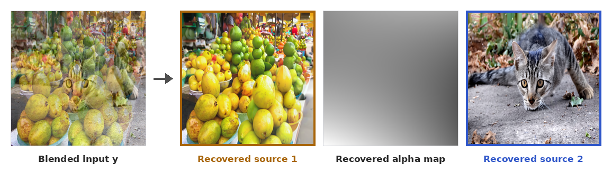
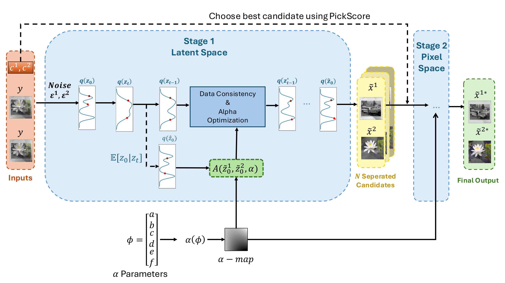

<div align="center">

# Image Deblending with Diffusion Models

**Dan Botchan · [Ohad Fried](https://www.ohadf.com/) · [Yacov Hel-Or](https://faculty.runi.ac.il/toky/)**<br>
Reichman University, Herzliya, Israel

**WACV 2027**

<!-- Add Paper and arXiv badges here once the links exist. -->
[](https://danbotchan.github.io/image-deblending-diffusion/)
[](#citation)
[](LICENSE)
[](#installation)



</div>

Official code for **Image Deblending with Diffusion Models**. Given a single alpha-blended
image and one short text prompt per source, the method recovers **both source images and the
alpha map**. It is training-free: it uses only pretrained diffusion priors and selects among
candidates without ground truth.

- **Two images from one prior.** Deblending is posed as a joint inverse problem, solved with
  diffusion posterior sampling over both sources at once.
- **Prompts settle the ambiguity.** Cross-negative prompting conditions each source on its own
  prompt and uses the other source's prompt as the negative.
- **Coarse to fine.** Stable Diffusion separates the semantics in latent space, then a
  pixel-space ImageNet diffusion model restores fine detail.
- **Spatially varying alpha.** The alpha map is a smooth 6-coefficient polynomial, optimized
  together with the images.

This repository is a paper-only extraction. It intentionally excludes exploratory DeepFloyd,
FLUX, SD3.5, and speed-search code, raw experiment galleries, private datasets, and baseline
source trees.

## Method



1. Stage 1 uses Stable Diffusion v1.4 at 512 x 512 for text-guided semantic separation.
2. Three stochastic candidates are generated with fixed per-pair seeds.
3. A frozen, permutation-invariant PickScore policy selects one candidate without ground truth.
4. Stage 2 uses OpenAI's unconditional 256 x 256 ImageNet diffusion model for pixel-space refinement.
5. PSNR, grayscale SSIM, and LPIPS are evaluated after resolving the two-source ordering by minimum total MSE.

Both stages use the same guided step: denoise each source, re-blend with the alpha map, and
update both samples from the data-consistency gradient. Stage 1 also updates the alpha
coefficients every 5 steps; Stage 2 keeps alpha fixed at the Stage-1 estimate and uses no prompts. The canonical pipeline takes approximately 50.6--71.0 minutes per
input on one NVIDIA RTX 3090, excluding selector overhead.

## Results

Known scalar alpha on the held-out Vehicles and Flowers domains (Table 1 of the paper; TF =
training-free). The full table, covering seen domains and the unknown-scalar and
spatially-varying scenarios, is in the paper and on the [project page](https://danbotchan.github.io/image-deblending-diffusion/).

| Method | TF | Vehicles PSNR ↑ | SSIM ↑ | LPIPS ↓ | Flowers PSNR ↑ | SSIM ↑ | LPIPS ↓ |
|---|:-:|--:|--:|--:|--:|--:|--:|
| DAD | | 11.088 | 0.432 | 0.504 | 11.446 | 0.387 | 0.522 |
| GIP | | 14.075 | 0.509 | 0.508 | 14.090 | 0.482 | 0.504 |
| BIDeN | | 15.437 | 0.552 | 0.385 | 15.690 | 0.542 | 0.379 |
| LCD | | 17.208 | 0.689 | 0.293 | 17.186 | 0.655 | 0.298 |
| DoubleDIP | ✓ | 13.696 | 0.480 | 0.510 | 13.709 | 0.437 | 0.525 |
| **Ours** | ✓ | **20.229** | **0.817** | **0.121** | **20.417** | **0.806** | **0.117** |

## Installation

Run all commands from the repository root. Use an NVIDIA GPU; the recorded environment
uses an RTX 3090 (24 GB), Python 3.9, PyTorch 2.5.1+cu121, and CUDA 12.1.

```bash
conda create -n deblend-paper python=3.9 -y
conda activate deblend-paper
pip install torch==2.5.1 torchvision==0.20.1 --index-url https://download.pytorch.org/whl/cu121
pip install -e .
```

See `requirements-lock-cu121.txt` for the recorded package versions.

### Download the models

Download both diffusion checkpoints before running either example:

1. Accept the terms for [Stable Diffusion v1.4](https://huggingface.co/CompVis/stable-diffusion-v-1-4-original)
   and download `sd-v1-4.ckpt` to `checkpoints/sd-v1-4.ckpt`.
2. Download the unconditional ImageNet model:

   ```bash
   curl -L --fail --output checkpoints/256x256_diffusion_uncond.pt \
     https://openaipublic.blob.core.windows.net/diffusion/jul-2021/256x256_diffusion_uncond.pt
   ```

If the files are stored elsewhere, set their paths instead:

```bash
export DEBLEND_SD14_CKPT=/absolute/path/to/sd-v1-4.ckpt
export DEBLEND_DDPM_CKPT=/absolute/path/to/256x256_diffusion_uncond.pt
```

PickScore downloads its pinned model and processor automatically on first use, so the
first run needs internet access. Once cached, pass `--offline` to the driver or custom-image
command. Further details: [model setup](docs/MODELS.md).

## Deblend your own image

No benchmark dataset or source images are needed. Supply the blended image and one short
prompt describing each source:

```bash
python scripts/deblend.py /absolute/path/to/blended.png \
  --prompt1 "A photo of lemons" \
  --prompt2 "A photo of a cat" \
  --output outputs/my_image
```

This generates three candidates, selects one with PickScore, and refines it in Stage 2.
The image is resized to 512 × 512 for Stage 1 and 256 × 256 for Stage 2; outputs are square.
The alpha map is estimated as a smooth polynomial. Results are under
`outputs/my_image/stage2/results/pair_000/smp_XXXX/`: `sample1.png`, `sample2.png`,
`pred_map.png`, and `alphas.json`. Source order can be swapped. Ground-truth metrics are
not computed for custom images.

Use `--gpu 0` to choose a GPU, `--seed 0` for repeatable sampling, or `--candidates 1` to
reduce sampling time. A full three-candidate run can take about an hour on an RTX 3090.
Add `--smoke` for a quick setup check with reduced steps; its output quality is not
representative. Choose a fresh output directory for each run.

## Set up the paper dataset

Paper evaluation needs the exact paired source images, in addition to the versioned
manifests. If you already have the prepared `BID_eval_v2` dataset, set it up with:

```bash
python scripts/prepare_dataset.py \
  --source-root /absolute/path/to/prepared/BID_eval_v2 \
  --output-root "$PWD/data_external/BID_eval_v2"
export DEBLEND_DATA_ROOT="$PWD/data_external/BID_eval_v2"
```

The setup command validates and copies the 600 source images used by the comparison
manifests. To use an existing directory without copying, run the same command with
`--check-only`, then set `DEBLEND_DATA_ROOT` to that source directory.

```text
$DEBLEND_DATA_ROOT/
└── pairs/
    ├── pair_000/
    │   ├── img1.png
    │   └── img2.png
    └── ...
```

The pipeline constructs the blended measurements from these sources and the alpha
coefficients in the manifests; precomputed blends are not needed for the main experiments.
For Vehicles/Flowers, use the prepared `BID_generalization` directory and add
`--split generalization` to the setup command.

**Dataset availability:** the prepared images are not included in this repository, and
there is currently no public prepared-data download or script to reconstruct every exact
pair from the upstream images. The setup command requires an existing prepared dataset.
Until the prepared data or a complete source mapping is released, new users can run their
own images using the command above. See [data details](docs/DATA.md).

## Reproduce the paper

One driver runs the supported pipeline experiments end to end (Stage 1, ground-truth-free selection, Stage 2,
evaluation) and writes `summary.md` and `summary.csv` under
`outputs/<split>/<experiment>/<scenario>/`. Smoke runs use `outputs/smoke/…`.
Set `DEBLEND_OUTPUT_ROOT` or pass `--output-root` to use a different output directory.

The release includes speed-oriented changes, including less frequent LPIPS guidance,
intended to shorten runtime while keeping scores close to the original implementation.
Their effect on the full paper scores has not yet been established; the sampled audit
found differences from the original outputs. See [verification](docs/VERIFICATION.md)
and [experiment caveats](docs/EXPERIMENTS.md#current-paper-audit-caveats).

After installing the models and preparing the dataset:

```bash
# Check the installation in a few minutes: 1 pair, ~10x fewer steps (numbers are meaningless)
python scripts/reproduce.py main --scenario spatial --smoke

# Main result and two-stage ablation for one scenario (one GPU)
python scripts/reproduce.py main --scenario known_scalar

# Held-out Vehicles/Flowers domains
python scripts/reproduce.py main --scenario spatial --split generalization \
  --data-root /absolute/path/to/BID_generalization
```

Commands use GPU 0 by default. Add `--gpus 0,1,2,3` to distribute pairs across four GPUs.
Scenarios are `known_scalar`, `unknown_scalar` and `spatial`. The supplementary experiments
are `text-guidance`, `timestep`, `recurrence`, `selector`, `candidate-budget` and
`auto-prompts`; `docs/EXPERIMENTS.md` maps each paper table to its command and protocol.
Add `--dry-run` to print the commands without sampling. Rerun the same command to resume
completed samples; use a new `--output-root` if you change run settings. Per-job logs are
in the run directory under `logs/`.

For most users, the driver is the simplest way to run the paper experiments. To run an
individual stage manually, use the commands printed by `--dry-run`; these include the
correct paths and configuration overrides for your chosen experiment.

## Documentation

| File | Contents |
|---|---|
| [`docs/EXPERIMENTS.md`](docs/EXPERIMENTS.md) | Every paper table and its command and protocol |
| [`docs/DATA.md`](docs/DATA.md) | Manifest schema, alpha coefficients, seeds |
| [`docs/MODELS.md`](docs/MODELS.md) | Pretrained checkpoints and where to put them |
| [`docs/BASELINES.md`](docs/BASELINES.md) | Baseline methods, adaptations, the DoubleDIP adapter |
| [`docs/GENERALIZATION.md`](docs/GENERALIZATION.md) | The held-out Vehicles/Flowers split |
| [`docs/VERIFICATION.md`](docs/VERIFICATION.md) | How the release was checked against the paper |

## Baselines

Baseline implementations are not vendored. `docs/BASELINES.md` records the upstream methods,
the paper adaptations, and the DoubleDIP adapter in `baselines/doubledip/`.

## Citation

```bibtex
@inproceedings{botchan2027deblending,
  title     = {Image Deblending with Diffusion Models},
  author    = {Botchan, Dan and Fried, Ohad and Hel-Or, Yacov},
  booktitle = {Proceedings of the IEEE/CVF Winter Conference on
               Applications of Computer Vision (WACV)},
  year      = {2027}
}
```

## Acknowledgements

This work builds on [Stable Diffusion](https://github.com/CompVis/stable-diffusion),
OpenAI's [guided-diffusion](https://github.com/openai/guided-diffusion) and
[PickScore](https://github.com/yuvalkirstain/PickScore). See `THIRD_PARTY_NOTICES.md` for the
upstream code and licenses.

## License

The project-owned code is released under the [Apache License 2.0](LICENSE), copyright 2026 Dan Botchan, Ohad Fried and Yacov Hel-Or (see [`NOTICE`](NOTICE)).

This does not cover third-party-derived source files, pretrained weights (Stable Diffusion v1.4, the OpenAI ImageNet diffusion model, PickScore) or datasets, which keep their own terms. See [`THIRD_PARTY_NOTICES.md`](THIRD_PARTY_NOTICES.md) and `licenses/` before redistributing.

## Project website

The static project website is in [`website/`](website/). Preview it with `python -m http.server 8000 --directory website`.
