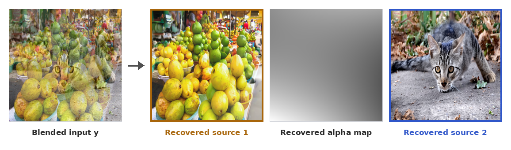
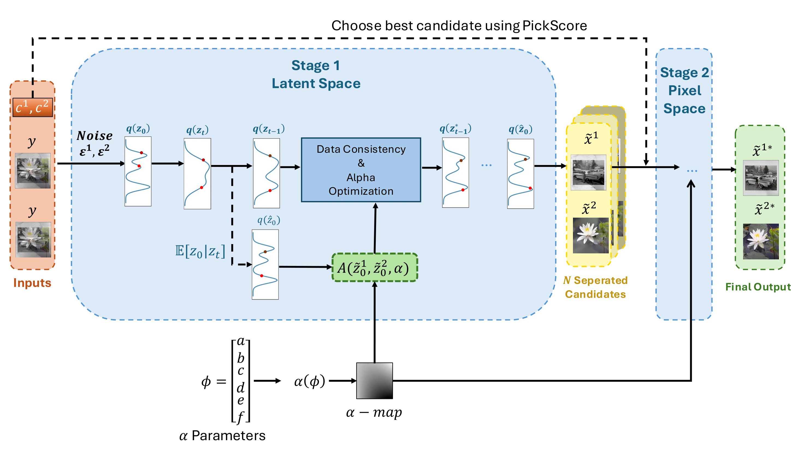

<div align="center">

# Image Deblending with Diffusion Models

**Dan Botchan · [Ohad Fried](https://www.ohadf.com/) · [Yacov Hel-Or](https://faculty.runi.ac.il/toky/)**<br>
Reichman University, Herzliya, Israel

**WACV 2027**

[](https://danbotchan.github.io/image-deblending-diffusion/)
[](#citation)
[](LICENSE)
[](#installation)



</div>

Official code for **Image Deblending with Diffusion Models**. Given a single alpha-blended
image and one short text prompt per source, the method recovers **both source images and the
alpha map**. It is training-free: it uses only pretrained diffusion priors and selects among
candidates without ground truth.

## Method



1. Stage 1 uses Stable Diffusion v1.4 in 64 × 64 latent space for 512 × 512 images. Each
   source uses its own prompt and the other source's prompt as the negative prompt.
2. A permutation-invariant PickScore selects one of three seeded candidates without ground truth.
3. Stage 2 refines that pair with OpenAI's unconditional 256 × 256 ImageNet diffusion model.

Both stages re-blend the source estimates and use the data-consistency gradient to update
both samples. The figure shows fixed-alpha refinement. The released main configurations
continue optimizing alpha in Stage 2 for unknown-scalar and spatial blends.

## Results

The [project page](https://danbotchan.github.io/image-deblending-diffusion/) shows qualitative
examples and Table 1 for all three blending scenarios.

## Installation

Run all commands from the repository root. The setup below uses Python 3.11 and
PyTorch 2.5.1 with CUDA 12.1. Inference requires an NVIDIA GPU with a CUDA 12.1-compatible
driver. The paper runs used an RTX 3090 (24 GB). Git is required to install OpenAI CLIP.

```bash
conda create -n deblend-paper python=3.11 pip -y
conda activate deblend-paper
python -m pip install torch==2.5.1 torchvision==0.20.1 --index-url https://download.pytorch.org/whl/cu121
python -m pip install -e .
python -m pip check
```

See [`requirements-lock-cu121.txt`](requirements-lock-cu121.txt) for the direct dependency pins.

### Download the models

Download both diffusion checkpoints before running either example:

1. Review the [Stable Diffusion v1.4 model license](https://huggingface.co/CompVis/stable-diffusion-v-1-4-original)
   and download [`sd-v1-4.ckpt`](https://huggingface.co/CompVis/stable-diffusion-v-1-4-original/resolve/main/sd-v1-4.ckpt)
   to `checkpoints/sd-v1-4.ckpt`.
2. Download the unconditional ImageNet model:

   ```bash
   curl -L --fail --output checkpoints/256x256_diffusion_uncond.pt \
     https://openaipublic.blob.core.windows.net/diffusion/jul-2021/256x256_diffusion_uncond.pt
   ```

If the files are stored elsewhere, set their paths instead:

```bash
export DEBLEND_SD14_CKPT=/absolute/path/to/sd-v1-4.ckpt
export DEBLEND_DDPM_CKPT=/absolute/path/to/256x256_diffusion_uncond.pt
```

Transformers downloads the pinned PickScore model and processor on first use. Once both
are cached, pass `--offline` to `scripts/deblend.py`, `scripts/reproduce.py`, or
`scripts/select_candidates.py` to load them from the cache.

## Deblend your own image

Try the bundled blended image with one short prompt per source. To use your own image,
replace the image path and both prompts.

```bash
python scripts/deblend.py website/static/img/teaser/input.webp \
  --prompt1 "A photo of lemons" \
  --prompt2 "A photo of a cat" \
  --output outputs/my_image
```

This generates three candidates, selects one with PickScore, and refines it in Stage 2.
The image is resized to 512 × 512 for Stage 1 and 256 × 256 for Stage 2. The results in
`outputs/my_image/stage2/results/pair_000/smp_XXXX/` include the two 256 × 256 source
estimates (`sample1.png` and `sample2.png`), the alpha-map visualization (`pred_map.png`),
and the six polynomial coefficients (`alphas.json`). Source order can be swapped. Ground-truth
metrics are not computed for custom images.

Use `--gpu 0` to choose a GPU, `--seed 0` for repeatable sampling, or `--candidates 1` to
reduce sampling time. A full three-candidate run can take about an hour on an RTX 3090.
For a quick installation check, add `--smoke --candidates 1` to run a single candidate at
reduced quality. Choose a fresh output directory for each run.

## Set up the paper dataset

The benchmark commands require an existing copy of the prepared BIDeN source pairs.
Follow the [data setup guide](docs/DATA.md#validate-or-copy-a-prepared-dataset) to validate
the images and set `DEBLEND_DATA_ROOT`.

## Run the paper experiments

One driver runs the supported pipeline experiments end to end (Stage 1, ground-truth-free selection, Stage 2,
evaluation) and writes `summary.md` and `summary.csv` under
`outputs/<split>/<experiment>/<scenario>/`. Smoke runs use `outputs/smoke/…`.
Set `DEBLEND_OUTPUT_ROOT` or pass `--output-root` to use a different output directory.

After installing the models and preparing the dataset:

```bash
# Check the installation in a few minutes: 1 pair, ~10x fewer steps (numbers are meaningless)
python scripts/reproduce.py main --scenario spatial --smoke

# Main result and two-stage ablation for one scenario (one GPU)
python scripts/reproduce.py main --scenario known_scalar
```

Commands use GPU 0 by default. Add `--gpus 0,1,2,3` to distribute pairs across four GPUs.
Scenarios are `known_scalar`, `unknown_scalar` and `spatial`. The supplementary experiments
are `text-guidance`, `timestep`, `recurrence`, `selector`, `candidate-budget` and
`auto-prompts`. See the [experiment map](docs/EXPERIMENTS.md) for supported commands,
settings, and differences from the paper's protocols, including the
[held-out Vehicles/Flowers runs](docs/EXPERIMENTS.md#held-out-vehicles-and-flowers).
Add `--dry-run` to print the commands without sampling. Rerun the same command to resume
completed samples; use a new `--output-root` if you change run settings. Per-job logs are
in the run directory under `logs/`.

For most users, the driver is the simplest way to run the paper experiments. To run an
individual stage manually, use the commands printed by `--dry-run`; these include the
correct paths and configuration overrides for your chosen experiment.

## Documentation

| File | Contents |
|---|---|
| [`docs/EXPERIMENTS.md`](docs/EXPERIMENTS.md) | Experiment commands, settings, and coverage |
| [`docs/DATA.md`](docs/DATA.md) | Manifest schema, alpha coefficients, seeds |
| [`docs/BASELINES.md`](docs/BASELINES.md) | Baseline methods, adaptations, the DoubleDIP adapter |

## Citation

```bibtex
@inproceedings{botchan2027deblending,
  title     = {Image Deblending with Diffusion Models},
  author    = {Botchan, Dan and Fried, Ohad and Hel-Or, Yacov},
  booktitle = {Proceedings of the IEEE/CVF Winter Conference on
               Applications of Computer Vision (WACV)},
  year      = {2027}
}
```

## Acknowledgements

This work builds on [Stable Diffusion](https://github.com/CompVis/stable-diffusion),
OpenAI's [guided-diffusion](https://github.com/openai/guided-diffusion) and
[PickScore](https://github.com/yuvalkirstain/PickScore). See `THIRD_PARTY_NOTICES.md` for the
upstream code and licenses.

## License

The project-owned code is released under the [Apache License 2.0](LICENSE), copyright 2026 Dan Botchan, Ohad Fried and Yacov Hel-Or (see [`NOTICE`](NOTICE)).

This does not cover third-party-derived source files, pretrained weights (Stable Diffusion v1.4, the OpenAI ImageNet diffusion model, PickScore) or datasets, which keep their own terms. See [`THIRD_PARTY_NOTICES.md`](THIRD_PARTY_NOTICES.md) and `licenses/` before redistributing.

## Project website

The static project website is in [`website/`](website/). From the repository root, run
`python -m http.server 8000 --directory website` and open <http://localhost:8000>.
